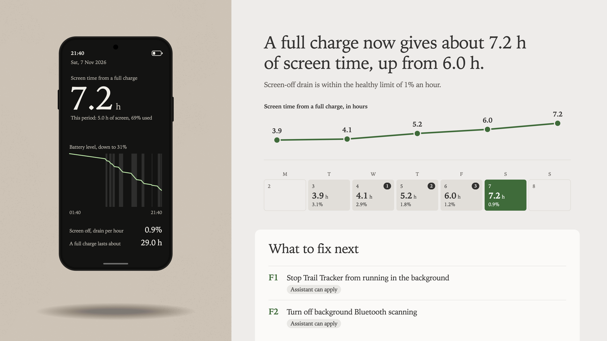

# battery-doctor

An agent skill that finds what drains your Android phone's battery, fixes it, and shows whether it got better.

You plug the phone into your computer and ask your AI assistant to check the battery. The skill investigates the phone's own records: what woke it, which apps ran in the background, which kept a sensor, Bluetooth scan or location request going, and how fast the battery fell with the screen off. It names the causes in plain words and writes a report you open in your browser.



## Why it exists

Android's battery screen lists apps by the share of battery they used. It does not show what keeps the phone busy while it sits in your pocket: an app holding a sensor on, a timer that wakes the phone hundreds of times a night, a service scanning for Bluetooth devices with Bluetooth switched off. Much of that drain is not attributed to any app, so the battery screen cannot point at it.

The phone does record all of it. The records are only reachable over USB and are thousands of lines long. This skill reads them, picks out what matters, and turns it into a short list of fixes.

## How it works

1. **Connect the phone.** A USB cable and one setting on the phone. The assistant walks you through it.
2. **Run a checkup.** It takes under a minute and investigates how fast the battery drains, which apps use it, and what keeps the phone awake.
3. **Read the report.** How long a charge lasts, how fast the phone drains when you are not using it, the causes, and a numbered list of fixes with what each one costs you.
4. **Pick the fixes you want.** The assistant applies the ones it can and gives you steps for the rest. Nothing changes on your phone without your yes, and changes are logged so they can be undone.
5. **Check again after a day of use.** The report keeps every checkup on a calendar, with your changes marked, so you see what worked.

## What you need

- An Android phone and a USB cable that carries data
- A computer running macOS, Windows or Linux
- An AI coding assistant that supports skills and can run commands (Claude Code, Codex, OpenCode, Gemini CLI, Cursor and others)
- [Node.js](https://nodejs.org) 18 or later

No root, no app to install on the phone, no account.

## Installation

### Claude Code (Plugin Marketplace)

1. Register the marketplace:

   ```bash
   /plugin marketplace add arifszn/battery-doctor
   ```

2. Install the plugin from this marketplace:

   ```bash
   /plugin install battery-doctor
   ```

### Other agents (Codex, OpenCode, Antigravity, Gemini, Cursor, …)

battery-doctor is a standalone skill that works in any agent supporting the `SKILL.md` format. See **[INSTALL.md](INSTALL.md)** for per-agent skills paths.

Just tell your agent to install it. Paste:

```
Fetch and follow the install instructions from
https://raw.githubusercontent.com/arifszn/battery-doctor/refs/heads/main/INSTALL.md
```

Or install it via npx:

```bash
npx skills add arifszn/battery-doctor
```

## Usage

Start with a checkup. The report opens in your browser with a numbered list of fixes:

```
/battery-doctor Check my phone's battery
```

Apply the fixes you want. Ask for one by its number:

```
/battery-doctor Apply fix F1
```

Or do it yourself on the phone. Fixes marked "Do it on the phone" come with the steps.

Use the phone for a day, then check again to see whether the fixes helped:

```
/battery-doctor Check again
```

Other things you can ask:

```
/battery-doctor Undo the last change
/battery-doctor Show the report
```

For the best checkup, use the phone unplugged for most of a day, do not restart it, and run the checkup before you charge.

## What it can change on your phone

Only these three things, and only after you agree to each one:

| Change | Effect | Undo |
|---|---|---|
| Restrict an app's background activity | The app stops running when it is not on screen | Yes |
| Close an app | The app stops until it is opened again | Not needed |
| Turn off background Bluetooth scanning, background Wi-Fi scanning, or always-on display | The setting goes off | Yes |

It only touches apps you installed, never apps that came with the phone. It never uninstalls, disables or erases anything. Every change is saved with its previous value in `~/battery-doctor/`.

## Privacy

- The checkup reads battery statistics, the list of installed apps and how long each was used.
- The raw data stays on your computer in `~/battery-doctor/`.
- Your AI assistant reads a summary that includes app names and usage times, so that summary goes to your assistant's provider.
- The report is a single file on your computer. It loads nothing from the internet.
- If `adb` is missing, the skill asks before downloading it from Google ([Android SDK Platform-Tools](https://developer.android.com/tools/releases/platform-tools), under Google's terms).

## Supported phones

Any Android phone that allows USB debugging. The skill reads standard Android statistics.

| Brand | Status |
|---|---|
| Samsung | Tested on a Galaxy S23 Ultra (Android 17). Most precise results. |
| Pixel, Xiaomi, OnePlus, OPPO, Motorola and others | Should work. Not yet tested on real phones. Some figures can be missing and show as a dash. |

If you try it on another phone, please [open a phone report](https://github.com/arifszn/battery-doctor/issues/new?template=phone-report.md).

## Running it without an assistant

```bash
node battery-doctor/scripts/doctor.mjs status    # is the phone connected
node battery-doctor/scripts/doctor.mjs check     # run a checkup and build the report
node battery-doctor/scripts/doctor.mjs report    # open the report
node battery-doctor/scripts/doctor.mjs fixes     # list the numbered fixes
node battery-doctor/scripts/doctor.mjs changes   # list changes made
node battery-doctor/scripts/doctor.mjs undo all  # reverse them
```

## Development

```bash
npm test
node tools/sync-root-skill.mjs   # after editing battery-doctor/SKILL.md
```

The tests use synthetic data and need no phone.

## License

[MIT](LICENSE)
